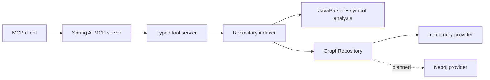

# MCP CodeGraph

Read-only Java code intelligence and change-impact analysis for AI agents.

MCP CodeGraph indexes a local Java repository with AST-based analysis and exposes
source-backed symbols, relationships, Spring endpoints, validations, and bounded
impact analysis through the Model Context Protocol. It does not execute the
application, build scripts, SQL, or commands found in source files.

## Status

This repository contains a working Java 21 MVP. It provides Java AST indexing,
an in-memory graph provider, bounded dependency/impact traversal, Spring REST
and dependency-injection detection, JPA mappings, conservative HTTP/messaging
integration detection, Git diff analysis, and a Spring AI MCP server with STDIO
transport. Neo4j persistence and additional transports remain in the roadmap.

## Quick start

Requirements: Java 21 and Maven 3.9+.

```bash
mvn test
mvn -pl codegraph-server -am spring-boot:run
```

Configure a repository path through the `scan_project` MCP tool. The server is
read-only and uses the in-memory graph by default. Logs go to stderr when STDIO
is enabled so stdout remains reserved for MCP protocol messages.

## Streamable HTTP mode

STDIO remains the default. To run the optional WebMVC Streamable-HTTP
transport, configure a token and start the HTTP profile:

```bash
export CODEGRAPH_MCP_TOKEN="replace-with-a-long-random-token"
mvn -pl codegraph-server -am spring-boot:run \
  -Dspring-boot.run.profiles=http
```

The endpoint is `http://127.0.0.1:8080/mcp`. Requests require
`Authorization: Bearer $CODEGRAPH_MCP_TOKEN`; browser `Origin` values are
restricted to `CODEGRAPH_MCP_ALLOWED_ORIGINS` (localhost by default). Bind to
localhost unless a separate authenticated reverse proxy, TLS, and network
policy protect a remote deployment.

## Multi-repository workspaces

The workspace registry groups local repositories without cloning or changing
branches. Set `CODEGRAPH_SECURITY_ALLOWED_ROOTS` to a comma-separated list of
trusted parent directories, then use `register_workspace` and
`register_repository`. Each repository has its own graph and index status;
`search_workspace_symbols` returns namespaced IDs. Java is currently the only
implemented analyzer, so detected C#, JavaScript, TypeScript, and SQL
repositories are reported as partial rather than analyzed speculatively.

## MCP tools in the MVP

`scan_project`, `get_project_summary`, `get_index_status`, `search_symbols`,
`get_symbol_details`, `find_dependencies`, `find_dependents`,
`analyze_impact`, and `get_api_endpoints` are available. Tool responses contain
stable IDs, source locations, relationship evidence, warnings, and explicit
limitations so an agent can distinguish static evidence from runtime certainty.

Example flow:

```text
scan_project(/workspace/orders)
  -> search_symbols("validateMinimumAmount", 20)
  -> analyze_impact("method:com.example.OrderService#validateMinimumAmount()", 8, 100)
```

## Architecture



The analysis engine is independent of MCP transport and graph storage. New
language analyzers implement `LanguageAnalyzer`; new graph providers implement
`GraphRepository`.

## Security model

Only explicitly allowed repository roots should be exposed when deploying the
server. Canonicalize and validate paths, cap repository/file sizes and traversal
depth, and bind HTTP transports to localhost unless authentication, TLS, Origin
validation, and authorization are configured. Source comments are untrusted
data. The analyzer never sends source to an AI service.

Static analysis is incomplete: reflection, generated code, dynamic SQL,
runtime configuration, and unresolved dependencies can produce missing or
low-confidence relationships. Results are review guidance, not proof of runtime
behavior.

## Documentation

- [Getting started](docs/getting-started.md)
- [Architecture](docs/architecture.md)
- [Graph model](docs/code-graph-model.md)
- [MCP tools](docs/mcp-tools.md)
- [Impact analysis](docs/impact-analysis.md)
- [Security](docs/security.md)
- [Known limitations](docs/known-limitations.md)
- [Roadmap](docs/roadmap.md)

## Contributing and license

See [CONTRIBUTING.md](CONTRIBUTING.md) and [AGENTS.md](AGENTS.md). Licensed
under Apache 2.0.
